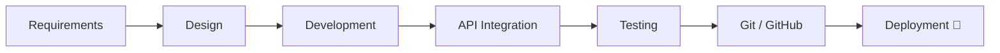
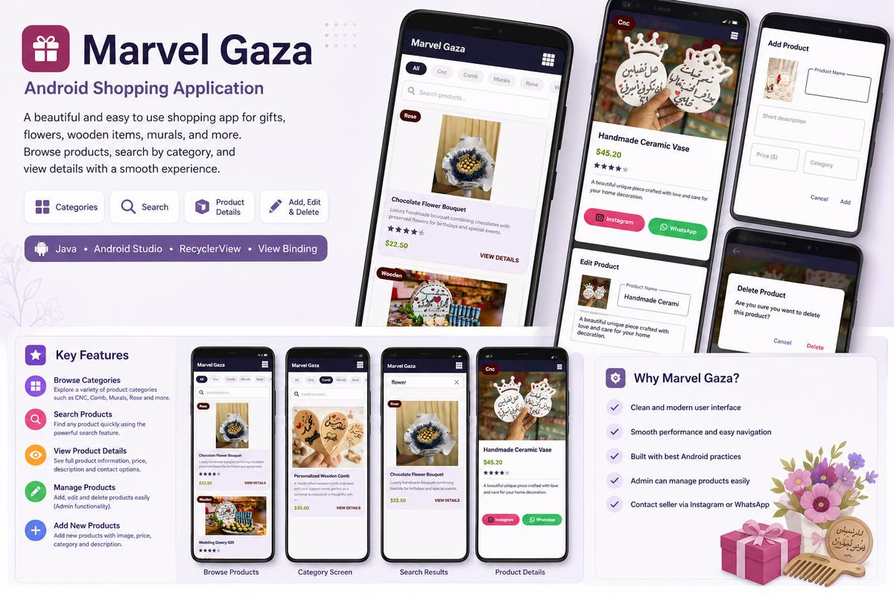
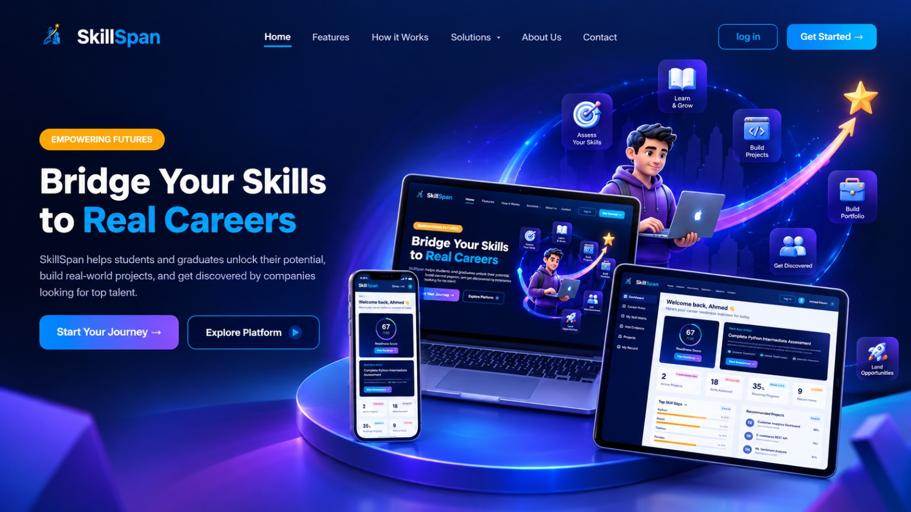
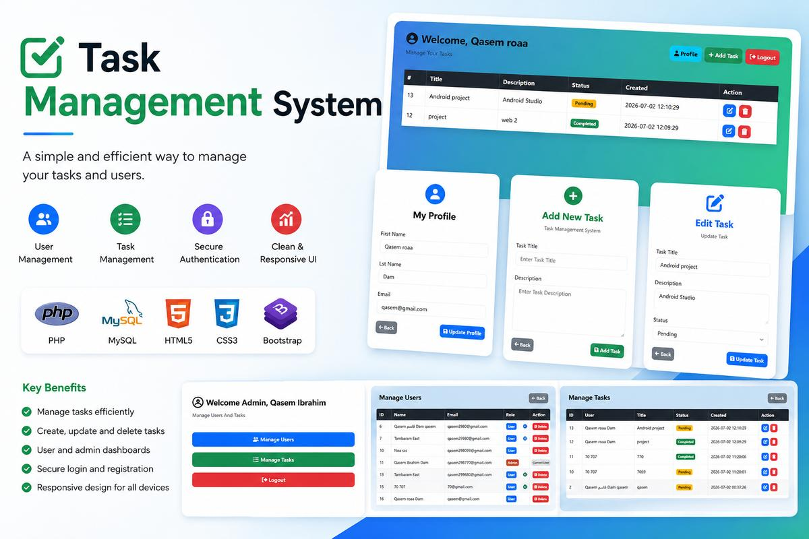

<div align="center">

[](https://git.io/typing-svg)

<hr>

<p>
  
  
</p>

<br>

<a href="https://www.linkedin.com/in/qasem-dam/">

</a>

<a href="https://github.com/qasemdam">

</a>

<a href="mailto:qasem2980@gmail.com">

</a>

<a href="https://wa.me/972594389670">

</a>

<a href="https://drive.google.com/uc?export=download&id=1vhEHqphz3eNBYV4G9IpIwiTSg0wBgQq7">

</a>

</div>

---

## 🚀 About Me

```dart
class Developer {
  final String name = 'Qasem AL-Dam';
  final String role = 'IT Student & Developer';
  final String location = 'Palestine';
  final List<String> languages = ['Arabic (Native)', 'English'];

  final List<String> coreFocus = [
    'Android Development',
    'Backend Development',
    'REST API Integration',
    'Database Design',
  ];

  String sayHi() => "Let's build something amazing! 🚀";
  bool isPassionateAboutDevelopment() => true;
}
```

---

## 🎨 Development Workflow



--- 

## 🚀 Featured Projects

<div align="center">

### 🛒 Marvel Gaza

Android shopping application built with Java, designed for browsing products, searching by category, viewing product details, and managing products.



**Tech:** Java • Android Studio • RecyclerView • View Binding

<br>

<a href="https://github.com/qasemdam/MarvelGaza">

</a>

---

### 🎯 SkillSpan

Career readiness and skill-matching platform designed to help students and graduates discover their skills, identify skill gaps, and explore career opportunities.



**Tech:** Laravel • PHP • MySQL • REST API

🔒 **Private Team Project**

---

### 📝 PHP Task Manager

Web-based task management system for creating, updating, deleting, and tracking tasks, with user and admin management.



**Tech:** PHP • MySQL • HTML • CSS • Bootstrap

<br>

<a href="https://github.com/qasemdam/Simple-Task-Management-System">

</a>

</div>

---

## 📜 Courses & Learning

- 📱 **Android Development with Java** — Android Studio & Native Android
- ⚙️ **Laravel & PHP Backend Development** — REST APIs & MySQL
- 🗄️ **Database Design & MySQL** — Relational Database Development
- 🌐 **Web Programming** — HTML • CSS • Bootstrap • JavaScript
- 🔎 **Information Retrieval** — Python • PyTerrier • BM25 • TF-IDF

---

## 🧠 Interests & Beyond Code

- 📱 Exploring Android development and modern mobile experiences
- ⚙️ Building practical backend systems and REST APIs
- 🧩 Improving software architecture and problem-solving skills
- 🚀 Turning ideas into real-world applications
- 📚 Continuous learning and exploring new technologies

---

## 📬 Let's Connect

<div align="center">

<a href="mailto:qasem2980@gmail.com">

</a>

<a href="https://www.linkedin.com/in/qasem-dam/">

</a>

<a href="https://wa.me/972594389670">

</a>

</div>

---

<div align="center">

**Made with 💙 by Qasem AL-Dam**

*Always learning. Always building. Always improving.* 🚀

</div>


